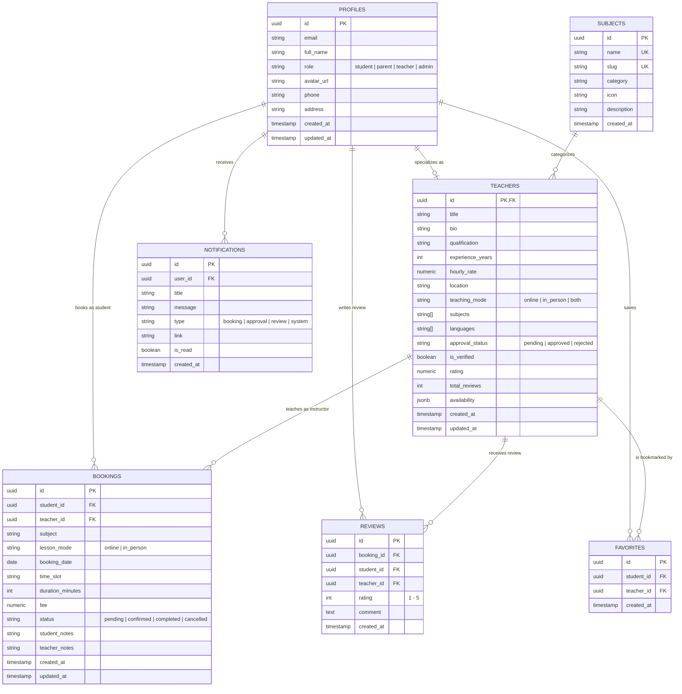

# MeroTutor Database Architecture & Schema Documentation

This document describes the complete relational database architecture, security policies, triggers, and deployment guidelines for **MeroTutor – Learn • Teach • Grow**.

---

## 1. Entity-Relationship Overview



---

## 2. Table Schemas & Foreign Keys

### `public.profiles`
Extends Supabase `auth.users` to manage user identity and roles.
- `id`: `UUID PRIMARY KEY REFERENCES auth.users(id) ON DELETE CASCADE`
- `email`: `TEXT NOT NULL`
- `full_name`: `TEXT NOT NULL`
- `role`: `TEXT NOT NULL CHECK (role IN ('student', 'parent', 'teacher', 'admin')) DEFAULT 'student'`
- `avatar_url`: `TEXT`
- `phone`: `TEXT`
- `address`: `TEXT`
- `created_at`: `TIMESTAMPTZ DEFAULT now()`
- `updated_at`: `TIMESTAMPTZ DEFAULT now()`

### `public.teachers`
One-to-one specialization of `profiles` where `role = 'teacher'`.
- `id`: `UUID PRIMARY KEY REFERENCES public.profiles(id) ON DELETE CASCADE`
- `title`: `TEXT NOT NULL` (e.g. "Senior Mathematics & Calculus Specialist")
- `bio`: `TEXT NOT NULL`
- `qualification`: `TEXT NOT NULL` (e.g. "M.Sc. Mathematics, Tribhuvan University")
- `experience_years`: `INTEGER NOT NULL DEFAULT 1`
- `hourly_rate`: `NUMERIC(10,2) NOT NULL DEFAULT 500`
- `location`: `TEXT NOT NULL` (e.g. "Kathmandu & Online")
- `teaching_mode`: `TEXT NOT NULL CHECK (teaching_mode IN ('online', 'in_person', 'both')) DEFAULT 'both'`
- `subjects`: `TEXT[] NOT NULL DEFAULT '{}'` (GIN indexed for array containment queries)
- `languages`: `TEXT[] NOT NULL DEFAULT '{"Nepali", "English"}'`
- `approval_status`: `TEXT NOT NULL CHECK (approval_status IN ('pending', 'approved', 'rejected')) DEFAULT 'pending'`
- `is_verified`: `BOOLEAN NOT NULL DEFAULT false`
- `rating`: `NUMERIC(3,2) NOT NULL DEFAULT 5.00`
- `total_reviews`: `INTEGER NOT NULL DEFAULT 0`
- `availability`: `JSONB NOT NULL` (day-of-week slots)
- `created_at`: `TIMESTAMPTZ DEFAULT now()`
- `updated_at`: `TIMESTAMPTZ DEFAULT now()`

### `public.bookings`
Manages lesson scheduling and requests between students and educators.
- `id`: `UUID PRIMARY KEY DEFAULT gen_random_uuid()`
- `student_id`: `UUID NOT NULL REFERENCES public.profiles(id) ON DELETE CASCADE`
- `teacher_id`: `UUID NOT NULL REFERENCES public.teachers(id) ON DELETE CASCADE`
- `subject`: `TEXT NOT NULL`
- `lesson_mode`: `TEXT NOT NULL CHECK (lesson_mode IN ('online', 'in_person')) DEFAULT 'online'`
- `booking_date`: `DATE NOT NULL`
- `time_slot`: `TEXT NOT NULL` (e.g. "16:00 - 17:00")
- `duration_minutes`: `INTEGER NOT NULL DEFAULT 60`
- `fee`: `NUMERIC(10,2) NOT NULL`
- `status`: `TEXT NOT NULL CHECK (status IN ('pending', 'confirmed', 'completed', 'cancelled')) DEFAULT 'pending'`
- `student_notes`: `TEXT`
- `teacher_notes`: `TEXT` (meeting link or confirmation notes)
- `created_at`: `TIMESTAMPTZ DEFAULT now()`
- `updated_at`: `TIMESTAMPTZ DEFAULT now()`

### `public.reviews`
Student ratings and feedback.
- `id`: `UUID PRIMARY KEY DEFAULT gen_random_uuid()`
- `booking_id`: `UUID REFERENCES public.bookings(id) ON DELETE SET NULL`
- `student_id`: `UUID NOT NULL REFERENCES public.profiles(id) ON DELETE CASCADE`
- `teacher_id`: `UUID NOT NULL REFERENCES public.teachers(id) ON DELETE CASCADE`
- `rating`: `INTEGER NOT NULL CHECK (rating >= 1 AND rating <= 5)`
- `comment`: `TEXT NOT NULL`
- `created_at`: `TIMESTAMPTZ DEFAULT now()`

### `public.favorites`
Saved bookmarks for teachers.
- `id`: `UUID PRIMARY KEY DEFAULT gen_random_uuid()`
- `student_id`: `UUID NOT NULL REFERENCES public.profiles(id) ON DELETE CASCADE`
- `teacher_id`: `UUID NOT NULL REFERENCES public.teachers(id) ON DELETE CASCADE`
- `created_at`: `TIMESTAMPTZ DEFAULT now()`
- `UNIQUE(student_id, teacher_id)`

### `public.notifications`
In-app notification system.
- `id`: `UUID PRIMARY KEY DEFAULT gen_random_uuid()`
- `user_id`: `UUID NOT NULL REFERENCES public.profiles(id) ON DELETE CASCADE`
- `title`: `TEXT NOT NULL`
- `message`: `TEXT NOT NULL`
- `type`: `TEXT NOT NULL CHECK (type IN ('booking', 'approval', 'review', 'system'))`
- `link`: `TEXT`
- `is_read`: `BOOLEAN NOT NULL DEFAULT false`
- `created_at`: `TIMESTAMPTZ DEFAULT now()`

---

## 3. Row Level Security (RLS) Policies

All tables have RLS enabled (`ALTER TABLE ... ENABLE ROW LEVEL SECURITY;`).

1. **Profiles**:
   - `SELECT`: Public profiles are readable by everyone.
   - `UPDATE`: `auth.uid() = id` (users can only update their own profile).
2. **Teachers**:
   - `SELECT`: Anyone can view approved teachers (`approval_status = 'approved'`). Unapproved applications can only be viewed by the applicant (`auth.uid() = id`) or Admins (`role = 'admin'`).
   - `INSERT`: `auth.uid() = id` (educators can submit their own application).
   - `UPDATE`: Teacher can update own profile, Admins can update any profile (e.g., approve/reject).
3. **Bookings**:
   - `SELECT`: `auth.uid() = student_id OR auth.uid() = teacher_id OR admin`.
   - `INSERT`: `auth.uid() = student_id`.
   - `UPDATE`: Student or Teacher or Admin.
4. **Reviews**:
   - `SELECT`: Publicly readable by all users.
   - `INSERT`: `auth.uid() = student_id`.
5. **Favorites**:
   - `SELECT`, `INSERT`, `DELETE`: Restricted to `auth.uid() = student_id`.
6. **Notifications**:
   - Restricted to `auth.uid() = user_id`.

---

## 4. Automated Database Triggers

1. **`on_auth_user_created`**:
   Automatically triggers when a new user signs up in `auth.users` via Email/Password or Google OAuth, inserting a matching row into `public.profiles` with `role`, `full_name`, and `avatar_url`.
2. **`on_review_added`**:
   Automatically calculates the average `rating` and increments `total_reviews` on `public.teachers` whenever a review is inserted, updated, or removed.
3. **`set_*_updated_at`**:
   Updates `updated_at = now()` before every update on `profiles`, `teachers`, and `bookings`.

---

## 5. Migration Execution

To apply this schema on your Supabase project:
1. Open your Supabase Dashboard: [https://app.supabase.com](https://app.supabase.com)
2. Go to **SQL Editor** in the left sidebar.
3. Open [`supabase/migrations/20261118000000_initial_schema.sql`](file:///c:/Users/ACER/OneDrive/Documents/viva%20project/supabase/migrations/20261118000000_initial_schema.sql).
4. Copy the SQL content, paste it into the SQL Editor, and click **Run**.
5. Copy your **Project URL** and **Anon Key** from **Project Settings > API** into your `.env` file:
   ```env
   VITE_SUPABASE_URL=https://your-project.supabase.co
   VITE_SUPABASE_ANON_KEY=your-anon-public-key
   ```
